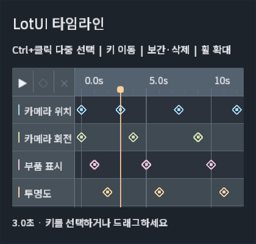
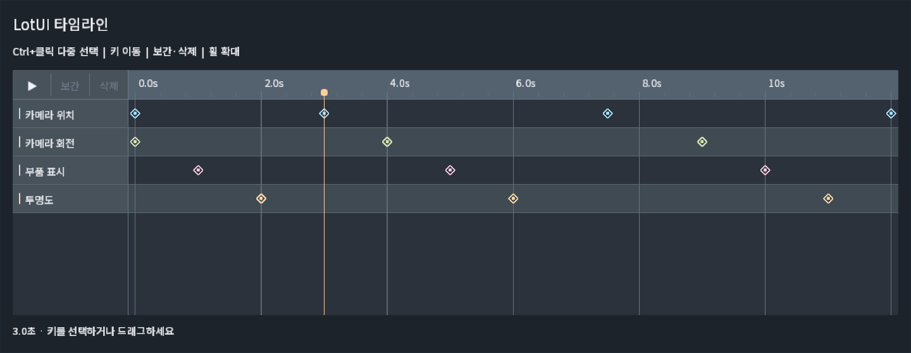
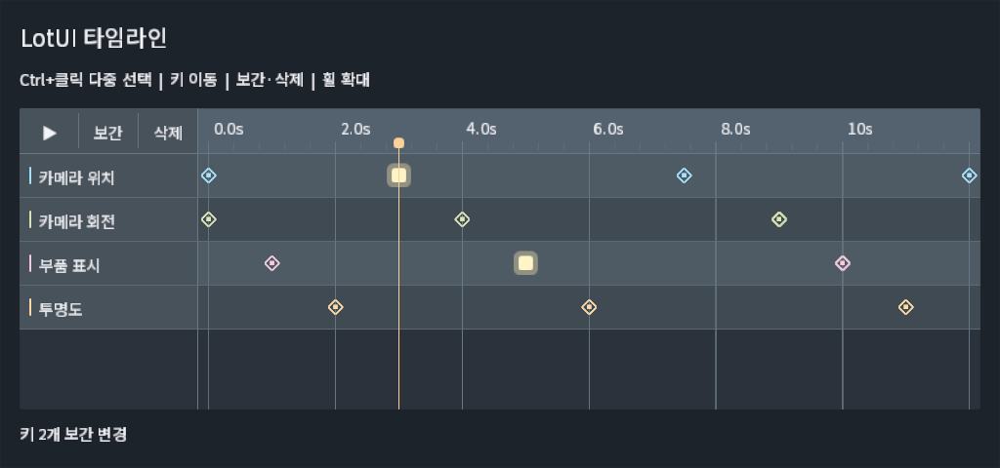
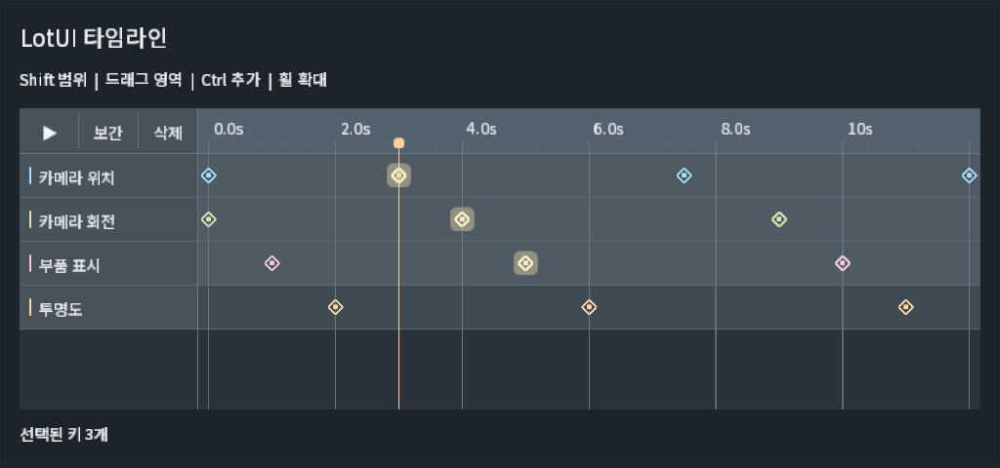
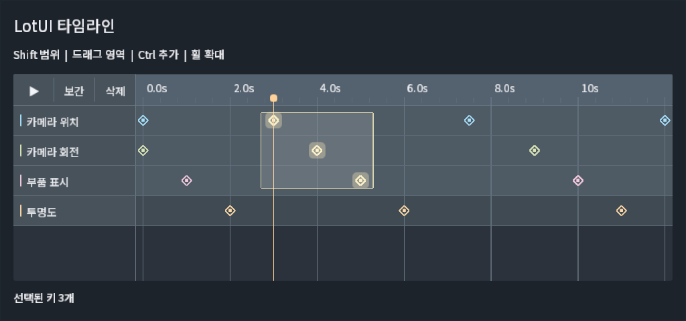

# TimelineView

`TimelineView` is a retained C++ keyframe timeline. Its public `TimelineTrack`
and `TimelineKey` types contain stable string IDs and seconds. The widget has
no CAD, Vulkan or operating system type in its API, so a plugin or host can
translate its own animation model into tracks.

```cpp
auto view = std::make_unique<lotui::TimelineView>(textEngine);
view->setDuration(12.0);
view->setTracks({{"camera", "Camera",
    {{"start", 0.0}, {"turn", 4.0}, {"end", 12.0}}}});
view->setOnTimeChanged([](double seconds) { /* seek the host */ });
view->setOnPlayChanged([](bool playing) { /* control playback */ });
view->setOnKeyMoved([](const lotui::TimelineKeyRef& key, double seconds) {
    // Commit one host Undo operation when the drag ends.
});
view->setOnKeysMoved([](const std::vector<lotui::TimelineKeyRef>& keys,
        double deltaSeconds) {
    // Commit a group drag as one host Undo operation.
});
view->setOnInterpolationChanged([](const auto& keys,
        lotui::TimelineInterpolation mode) { /* update the host */ });
view->setOnKeysDeleted([](const auto& keys) { /* delete in the host */ });
```

The header is `widgets/timeline_view.h`. `setTracks()` validates IDs and finite,
nonnegative key times before replacing the current model. The selected key is
identified by track ID plus key ID. Ctrl/Command click adds or removes keys
from the selection; dragging any selected key moves the group without changing
their spacing. The ruler supports scrubbing, the wheel zooms around the
pointer, and the three compact header controls toggle playback, cycle the
selected keys through smooth/linear/step interpolation, and delete them.
Shift click selects keys in the time range between the anchor and clicked key;
when the keys are on different tracks, it includes the tracks between them.
Ctrl/Command+Shift adds that range. Dragging from empty track space draws a
selection rectangle; Ctrl/Command adds its keys to the current selection.
Cancelling the pointer drag restores the previous selection. Clicking empty
track space without dragging still seeks and clears the selection.
The track-name column narrows with the widget, while the ruler recomputes its
tick spacing and keeps tick labels inside the visible edge. In compact panels,
the interpolation and delete controls show symbols; all three remain clickable.
Resize does not change key times or selection.
The ruler has subdued minor ticks, each track carries a narrow color accent,
and smooth/linear/step keys use diamond/rounded/square marks. Selected keys
receive a soft halo and their track row gains a subtle highlight. The painted
mark stays within the same hit area used for pointer selection and dragging.
Space toggles playback, F2 cycles interpolation, Delete removes selected keys,
Left/Right seek and Home returns to zero. Key dragging previews locally and
calls `setOnKeysMoved()` once on release when that callback is installed. A
cancelled drag restores the original times. The host owns playback, Undo and
model persistence.

Run `timeline_view_demo`, `timeline_view_demo --smoke`, or
`timeline_view_demo --capture output.ppm`, or
`timeline_view_demo --capture-edits output.ppm` to capture a multi-key
selection. `--capture-compact output.ppm` and
`--capture-expanded output.ppm` capture the narrow and wide layouts. The same
demo builds separately in
`LotGUI_Sample` against the static DesktopSDK through `find_package(LotUI)`.
`--capture-range output.ppm` and `--capture-marquee output.ppm` show the two
multi-selection gestures.

| Compact window | Expanded window |
| --- | --- |
|  |  |



| Shift range | Drag selection rectangle |
| --- | --- |
|  |  |

The 3dEngine adapter lives in its `samples/lotui_smoke` directory. It reads
real timeline tracks through the engine C API and checks group drag,
interpolation, deletion, Undo/Redo, scrubbing and zoom with
`LotCADLotGUI --timeline-test`. Clip lanes and range selection remain outside
this control.
