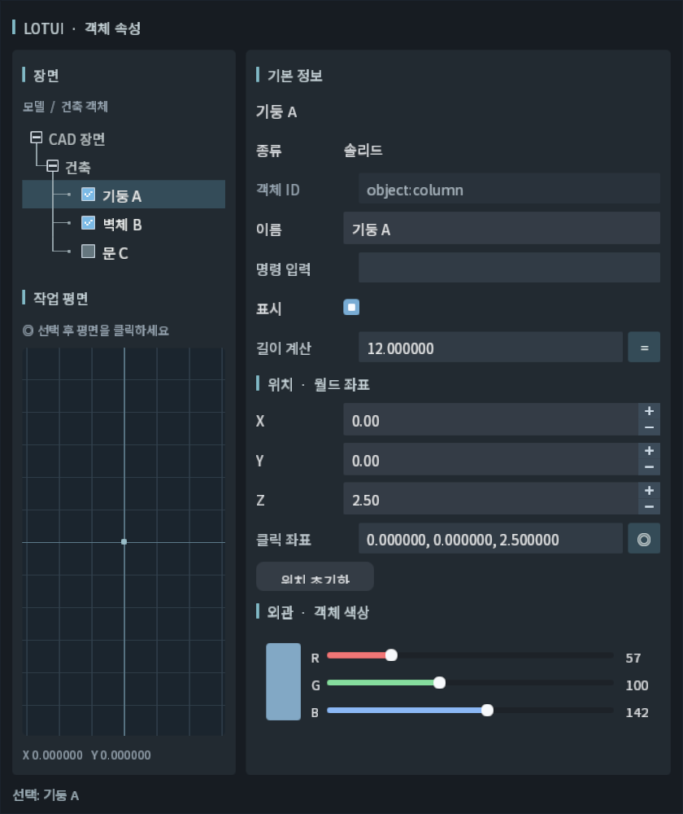

# CAD inspector example

This standalone LotUI example models the scene-tree and property-panel workflow
used in the sibling 3dEngine project. It builds with LotUI only. Selecting an
object in the tree refreshes its name, visibility, world position, and color.
Edits update the selected object; a visibility edit also updates the tree
checkbox. The tree shows scene, folder, and object icons; applications and
plugins can supply a registered image texture for individual nodes. The reset
button sets X, Y, and Z to zero.
The adjacent copy button writes the selected object's X, Y, and Z values to
the native clipboard as comma-separated numbers with the editor's decimal
precision. Hosts and plugins can use `Vector3Input::clipboardText()` with
their own clipboard service.

`PropertyField` demonstrates access modes and host actions: object ID is
read-only, the command input is write-only and clears after submission, the
length field evaluates basic arithmetic, and the point button arms a click on
the small scene surface. The sample maps that click to an XY world point and
updates the selected object's position. In 3dEngine the host adapter should
request `CAD_EdGetPoint`, pass the returned world coordinates to
`PropertyField::acceptPoint`, and apply the value through the engine object API.
The field never owns the engine viewport or its input state.

The example composes public `TreeView`, `TextField`, `Checkbox`,
`Vector3Input`, `PropertyField`, and `ColorEditor` widgets. `Vector3Input`
keeps X/Y/Z fields aligned and reports the changed axis; the host callback
still owns the model update and Undo transaction. Its small `CadObject` model and
callbacks live in `main.cpp`, so an engine can replace the in-memory model
with its own adapter. In 3dEngine, the corresponding API calls are
`CAD_GetSelection`, `CAD_GetObjectName` / `CAD_SetObjectName`,
`CAD_IsObjectVisible` / `CAD_SetObjectVisible`, `CAD_GetPosition` /
`CAD_SetPosition`, and `CAD_GetColor` / `CAD_SetColor`. Engine-side code must
validate edits and refresh the panel when engine selection or scene revision
changes. No engine headers or classes are linked into LotUI.

Build and run from the repository root:

```sh
cmake -S . -B build -DLOTUI_BUILD_EXAMPLES=ON
cmake --build build --config Release --target cad_inspector_demo
```

The executable is `build/Release/cad_inspector_demo.exe` on Windows. Run
`--self-test` to exercise 680×900 and 1200×1100 layouts, aligned XYZ fields,
tree selection, numeric editing, access modes, expression evaluation, point
picking, visibility, naming, and reset. `--capture output.ppm` saves a
Vulkan-rendered frame; `--capture-compact` and `--capture-expanded` save the
same screen in small and large windows.

The native window keeps its client area at least 680×900 when resized. The
compact capture uses the minimum supported layout size.


