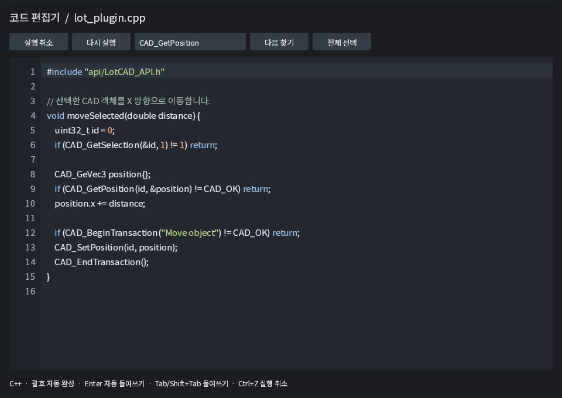

# Code editor example

This standalone Vulkan example uses the public `lotui::CodeEditor` widget to
edit a C++ snippet that calls the 3dEngine C API. The snippet is demonstration
text; LotUI does not link to 3dEngine or execute the code.

The editor supports line numbers, shared syntax colors for C++ and other
languages accepted by `tokenizeCodeLine`, pointer selection, UTF-8 insertion,
IME composition, automatic `()`, `[]` and `{}` pairing, selection wrapping,
paired deletion, four-space indentation after `{`, aligned closing braces,
Tab/Shift+Tab indentation, find-next, clipboard shortcuts, vertical
scrolling, and Undo/Redo. The toolbar demonstrates its public API. Code text
and callbacks stay in the consumer application; plugins can instantiate the
same widget using the SDK `LotUI::Widgets` target.

From the LotGUI repository root:

```sh
cmake -S . -B build -DLOTUI_BUILD_EXAMPLES=ON
cmake --build build --config Release --target code_editor_demo
```

On Windows, run `build/Release/code_editor_demo.exe`. Use `--self-test` for the
example state check or `--capture output.ppm` to save the Vulkan frame.


