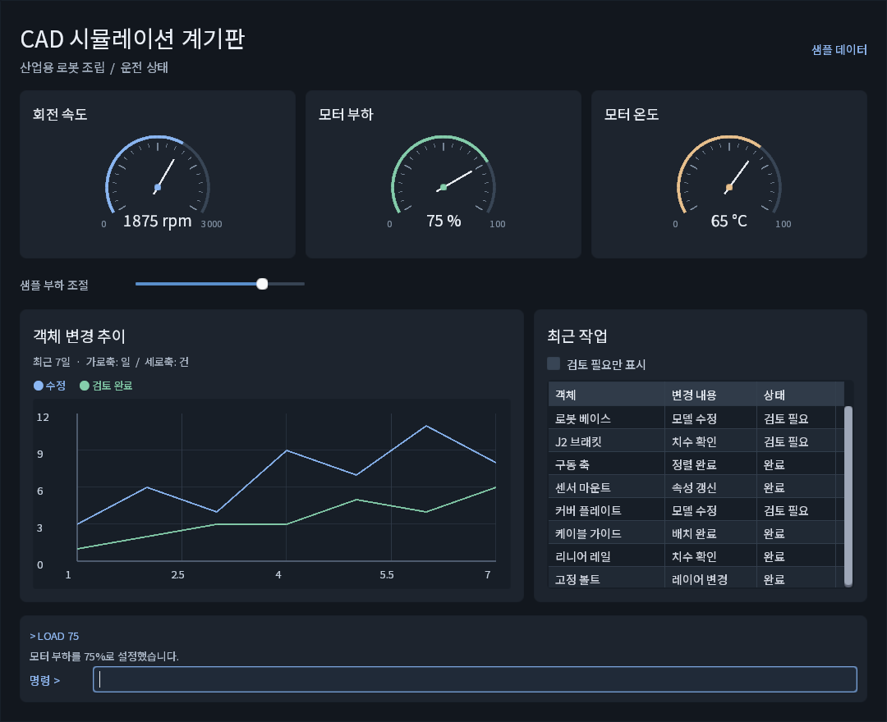

# CAD dashboard example

This desktop Vulkan sample combines three analog gauges, a line chart, a
filterable activity table, and a keyboard command prompt. The instruments
display sample RPM, motor load, and temperature. Drag the load slider or run
`LOAD 75` in the command prompt to update all three gauges.

Click the command field and press Enter to submit. Up and Down browse typed
commands, and Esc clears the current entry. `HELP` lists commands, `STATUS`
shows the sample load, and `CLEAR` clears the visible output.

The gauge is a custom LotUI widget in the example. The remaining controls use
the public SDK. For an engine-hosted version, connect the prompt to
`CAD_ExecuteCommand` and `CAD_EdGetCommandState`, and read the transcript with
`CAD_EdGetCommandHistory`. The sample command handlers use local data.

Build from the LotGUI repository root:

```sh
cmake -S . -B build -DLOTUI_BUILD_EXAMPLES=ON
cmake --build build --config Release --target dashboard_demo
```

On Windows, run `build/Release/dashboard_demo.exe`. Use `--smoke` to check the
filter, slider, command submission, and command recall. Use
`--capture-command output.ppm` to capture the frame after `LOAD 75`.


