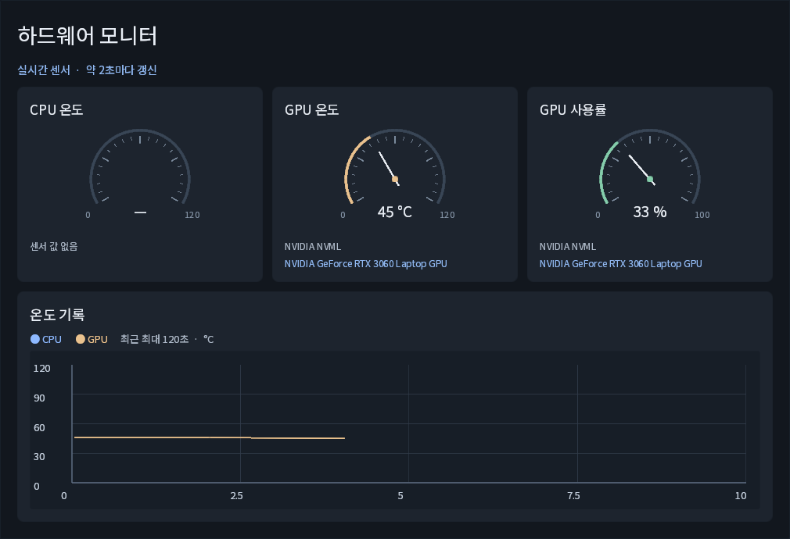

# Hardware monitor example

The LotUI instrument panel shows CPU package temperature, GPU temperature,
and GPU utilization. It polls the local sensor sources about every two seconds
and draws the last 120 seconds of temperature readings. A sensor without a
reading displays an em dash.

| Platform | Sensor sources |
|---|---|
| Windows | NVIDIA GPU 0 through the [installed NVML driver library](https://docs.nvidia.com/deploy/nvml-api/latest/nvml-api-reference.html). CPU package readings come from the [LibreHardwareMonitor metrics endpoint](https://github.com/LibreHardwareMonitor/LibreHardwareMonitor/blob/master/LibreHardwareMonitor.Windows.Forms/Utilities/HttpServer.cs) when already available at `http://127.0.0.1:8085/metrics`. |
| Linux | [Intel coretemp](https://docs.kernel.org/hwmon/coretemp.html) package and [AMD k10temp](https://docs.kernel.org/hwmon/k10temp.html) Tdie sensors. AMD GPU temperature and utilization come from the amdgpu sysfs files when exposed. |
| macOS | The sample builds with an unavailable sensor provider. |

Windows sensor reads do not require any vendor SDK headers. The app loads the
driver's NVML library from the system directory when present. LibreHardwareMonitor
is an optional provider configured outside the sample, with a loopback address.
The app only reads its metrics endpoint. The GPU card names the monitored device,
which can differ from the device Vulkan uses for rendering.

Build from the LotGUI repository root:

```sh
cmake -S . -B build -DLOTUI_BUILD_EXAMPLES=ON
cmake --build build --config Release --target hardware_monitor_demo
```

Run `build/Release/hardware_monitor_demo.exe` on Windows.
`--read-sensors` prints one reading without creating a window.
`--capture output.ppm` captures the panel after collecting live readings.


