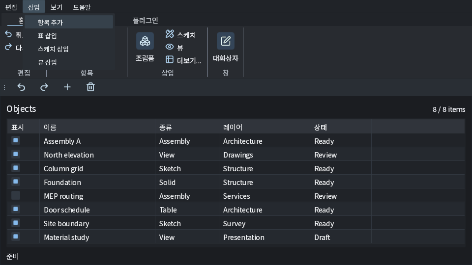
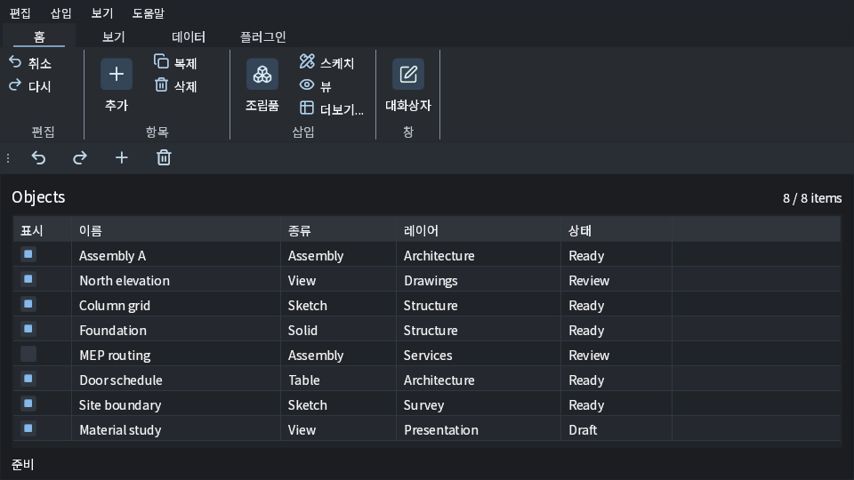
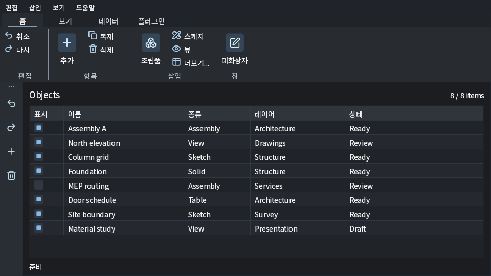
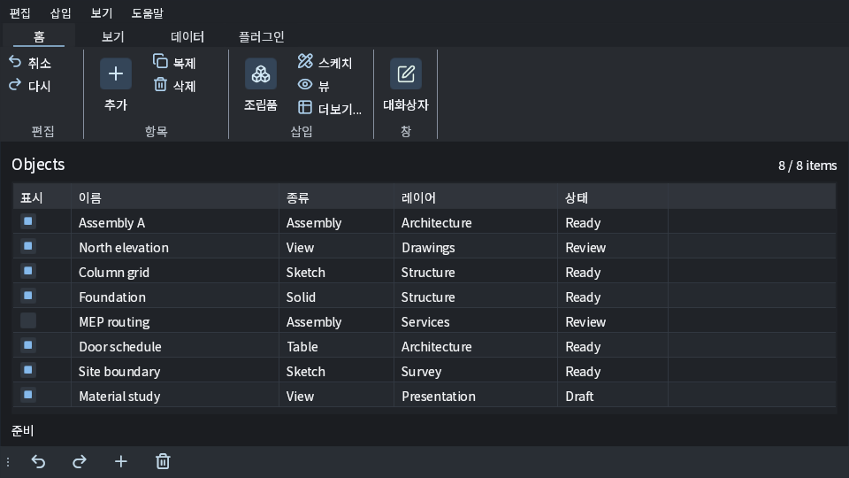
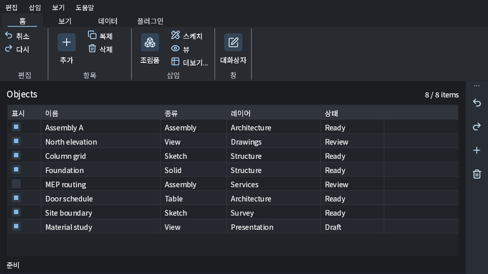
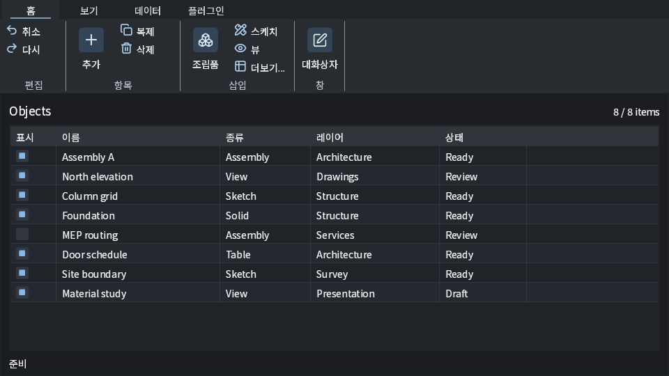
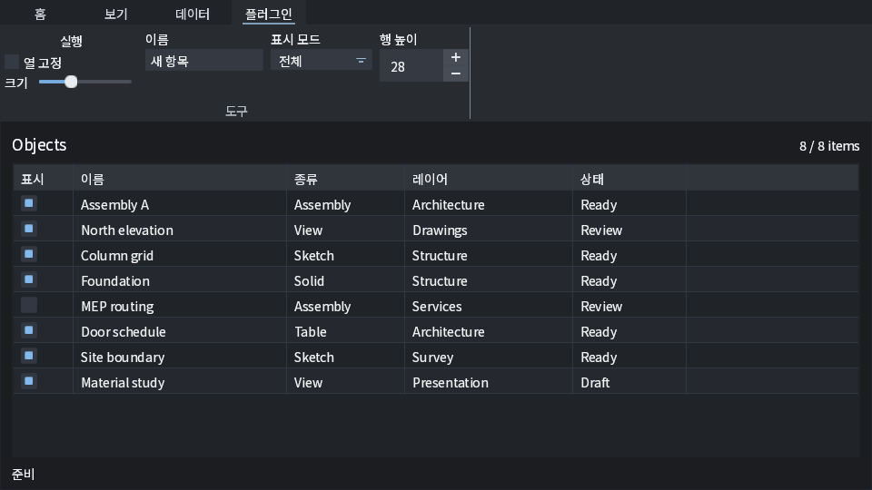
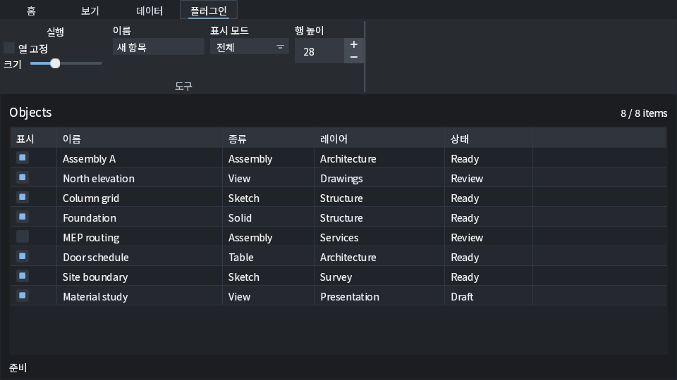
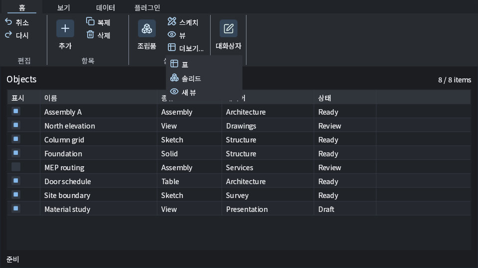
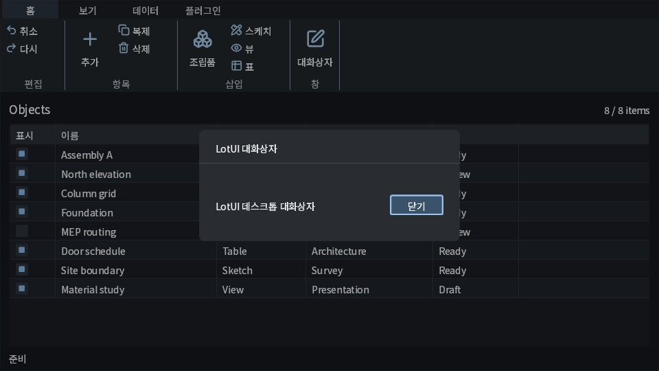

# Standalone ribbon demo

`ribbon_demo` is a LotUI-only native-window example. It does not include or
link 3dEngine. Its 134-pixel ribbon and object list use the same public widget
API as the engine integration sample. The four tabs are Home, View, Data, and
Plugin. A pull-down menu above the ribbon exposes Edit, Insert, View, and Help
commands. `--capture-menu output.ppm` captures an open menu; `--input-test`
checks its Insert and Undo actions. Home combines tall primary commands with two- or three-row secondary
commands in equal-height ribbon panels. Home provides add, duplicate, delete,
undo, redo, a modal dialog, and assembly/sketch/view insertion. View
changes row density and frozen
columns. Data sorts, filters, shows selected-row details, and changes
visibility. The list itself supports row selection and visibility checkboxes.


The compact **More** command in the Insert group opens a popup with Table,
Solid, and View insertion choices. Selecting one adds an object to the list and
closes the popup; the ribbon keeps its 134-pixel height.

A compact quick toolbar sits under the ribbon. Drag its dotted grip to the
top, bottom, left, or right edge of the workspace; the highlighted edge shows
the pending dock position. The Undo, Redo, Add, and Delete commands retain
their callbacks and use the same Lucide icon font as the ribbon. Dropping in
the center leaves the toolbar on its current edge. `--input-test` checks all
four positions and command clicks. Capture any docked layout with
`--capture-dock-left`, `--capture-dock-bottom`, or `--capture-dock-right`.






Ribbon commands use a 20-glyph subset of the Lucide 1.55.0 icon font. The
subset is stored in `resources/fonts/lucide-subset.ttf`; its ISC/MIT license
notice is in `resources/LUCIDE-LICENSE.txt`. Icons are rendered through the
same FreeType text engine on all supported platforms.
Large commands show the icon in a restrained tile while smaller commands keep
an unfilled, aligned icon and text row.
The selected tab uses the same surface color as the command panels below it.
Hover uses a slightly lighter neutral color; mouse and keyboard focus have a
thin muted outline rather than a bright frame. A 2-pixel inset underline marks
the selected tab without adding height. The example-local
`RibbonSelectionAccent` wraps the public `Ribbon` widget and paints this line
after the active tab, so existing SDK builds can run the example unchanged.

The Assembly and Dialog commands also demonstrate **image-file icons**.
`resources/icons/assembly.tga` and `dialog.tga` are 40 x 40, top-left-origin,
uncompressed 32-bit TGA images. At startup, the example resolves them relative
to `executableDirectory()`, decodes them with the example-local `tga_image.cpp`,
uploads each `TextureImage` with `VulkanRenderer::createTexture`, and assigns
its `TextureId` to the icon `Box` with `setTexture`. The returned `Texture`
objects stay alive until the widget tree is destroyed. Replace the two TGA
files to try your own icons; CMake copies them next to the executable and
installs them with the example. For PNG or JPEG, decode the file with your
application's image library into RGBA pixels and use the same texture API.
This small TGA reader is demonstration code, not part of the LotUI SDK.

`ribbon_demo_plugin` is a separate shared library loaded beside the executable.
Its V1 entry point returns a versioned C descriptor from `plugin_api.h` for a
button, checkbox, and slider. An optional V2 entry point adds a UTF-8 text
field without changing the V1 descriptor. The host validates both descriptors
and creates ordinary LotUI widgets in `plugin_tab.cpp`; the plugin does not
link LotUI or own Vulkan objects. Plugin actions add a row, freeze the name
columns, change row density, and receive text submitted with Enter. The text
callback's UTF-8 pointer is valid only during the call. The plugin stays loaded
until its widget tree is gone.
The optional V3 entry point adds a combo box and numeric input. The DLL
provides labels, options, ranges, initial values, and callbacks; the host
creates LotUI controls inside the ribbon and routes changes to the object
list. Older hosts can continue using V1. This demo loads a plugin DLL while
linking LotUI through SDK static libraries; the plugin does not export the
LotUI C++ ABI.
This example ABI is intentionally local to the demo, not a stable public SDK.

Build and run:

```sh
cmake -S . -B build -DLOTUI_BUILD_EXAMPLES=ON
cmake --build build --config Release --target ribbon_demo
```

Run `ribbon_demo` from the build output's `Release` directory on Windows, or
from the matching build output directory on macOS/Linux. `--smoke` loads the
plugin, renders a few frames, and exits. `--input-test` checks workspace
commands, ribbon tab switching, and all six plugin controls' callbacks,
including Korean text input. `--input-test-v1` verifies that the original
three controls still work when the optional V2 entry point is ignored.
`--capture-plugin output.ppm` writes a frame from the Vulkan renderer without
depending on desktop capture.
`--capture-dialog output.ppm` captures the modal dialog. The demo palette is
specified in sRGB display colors and converted to linear renderer colors, so
the dark desktop tone is consistent with the Vulkan sRGB swapchain. Ribbon and
list text use 14-pixel Noto Sans KR with high-contrast foreground colors.
`--capture-home output.ppm` captures the ribbon icon layout, including both
image-file icons. `--input-test` also checks that both textures appear in the
paint commands.
`--capture-clicked-plugin output.ppm` clicks the Plugin tab through the widget
input path and captures its selected and focused appearance.
`--capture-insert-menu output.ppm` captures the Insert group's popup. The
`--input-test` path opens this menu and selects Table through pointer input.







Design references: [AutoCAD ribbon tabs and panels](https://help.autodesk.com/cloudhelp/2026/ENU/AutoCAD-Core/files/GUID-D20EF1D7-4135-48A7-B68E-65BF3BFF3D70.htm)
and [Windows Ribbon size definitions](https://learn.microsoft.com/en-us/windows/win32/windowsribbon/windowsribbon-templates).

To stage a separate example distribution:

```sh
cmake --install build --config Release --component Examples --prefix build/ribbon-demo-dist
```

The `Examples` component contains `bin/ribbon_demo` (or
`bin/ribbon_demo.exe`), the adjacent `ribbon_demo_plugin` shared library,
`bin/resources/fonts/NotoSansKR-Regular.ttf`,
`bin/resources/fonts/lucide-subset.ttf`, `bin/resources/icons/*.tga`, and
`bin/legal`. Keep the
executable and plugin together. Configure `LOTUI_EXAMPLE_FONT_FILE` with a
licensed Noto Sans KR font if the default sibling font is unavailable. Verify
the font's provenance and matching OFL notice before distributing the package.
A Vulkan runtime is required on the target machine.
